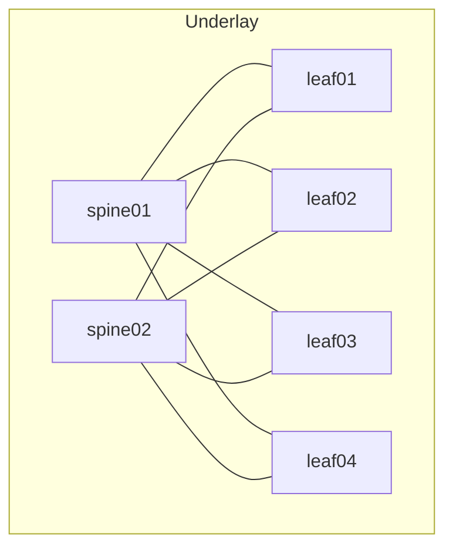
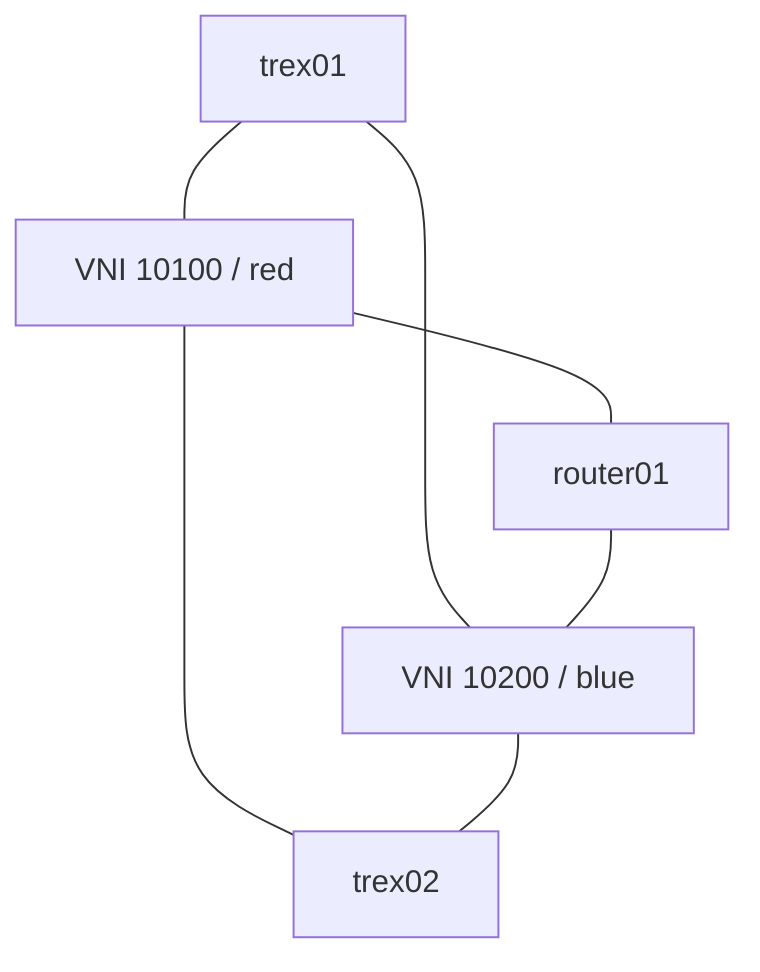

# Fabric och trafikvägar

Varje TRex har två dataportar. Trafikprofilen använder gateway-MAC och mål-IP i **det andra** subnätet. Routern har ett dedikerat interface per VNI och routar IPv4 mellan dem. EVPN/VXLAN distribuerar L2-segmenten över fabricen. Managementtrafik går separat i Airs OOB-nät.
